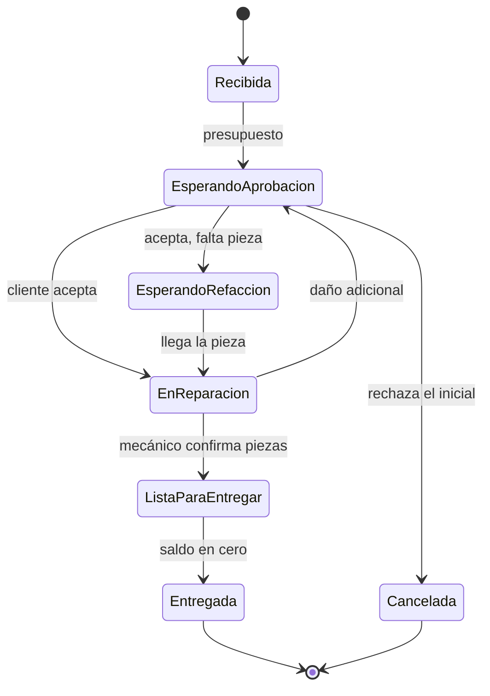

# Taller al Día

Sistema de gestión para un taller de bicicletas: recibir la bici, presupuestar, reparar, cobrar y entregar, con
inventario de refacciones que nunca queda en negativo y permisos distintos para recepción, mecánicos y dueño.

> **Proyecto escolar** de la materia **Ingeniería de Software** · Universidad Tecnológica de la Mixteca ·
> Grupo 502-B · **Equipo V** · Docente: Mario Alberto Moreno Rocha.
> El cliente, Óscar Ramírez, es un personaje simulado del curso; sus mensajes llegan por Slack.

## Estado del proyecto

| | |
|---|---|
| Fase | Especificación terminada; **el sistema aún no se implementa**. |
| Alcance | **Aprobado** por el cliente el 3 de noviembre de 2026 (con cinco ajustes). |
| Entrega 0 | Prototipo HTML navegable (v0.3), `taller-al-dia-prototipo-v2.html`. |
| Siguiente | Entrega 1: inicio de sesión, roles, registro de cliente y bicicleta, orden con folio. |
| Por cerrar | Aprobación expresa del SRS por Óscar (PEN-007) y tres datos suyos (mínimos de reposición, % de anticipo, catálogo de piezas). |

## Qué contiene este repositorio

Documentación del proyecto (tres PDF y su transcripción a Markdown) más el prototipo HTML de la Entrega 0.

| Archivo | Qué es |
|---|---|
| [`SRS_Taller_al_Dia.pdf`](Documents/SRS_Taller_al_Dia.pdf) | **Especificación de requisitos (SRS) v0.2**, 42 páginas, formato IEEE 830. Es el documento normativo. |
| [`Reporte_Taller_al_Dia.pdf`](Documents/Reporte_Taller_al_Dia.pdf) | Reporte del segundo parcial: entrevistas de Slack, resumen del SRS, método Scrum, métricas, plan y minuta de alcance. |
| [`Taller_al_Dia_Flujo_del_sistema_v0.3.pdf`](Documents/Taller_al_Dia_Flujo_del_sistema_v0.3.pdf) | Flujo del sistema: roles, estados de la orden, inventario, cobro, datos y pantallas. |
| [`taller-al-dia-prototipo-v2.html`](taller-al-dia-prototipo-v2.html) | Prototipo HTML navegable v0.3 (Entrega 0): un solo archivo, sin servidor. Se abre con doble clic. Cómo funciona: [`docs/architecture.md`](docs/architecture.md). |
| [`docs/`](docs/README.md) | Documentación en Markdown, incluidas las **transcripciones** de los tres PDF. |
| [`CLAUDE.md`](CLAUDE.md) | Instrucciones para el asistente Claude Code (contexto y reglas del proyecto). |

## Cómo leer la documentación

1. [`docs/proyecto.md`](docs/proyecto.md): qué es, quiénes participan, plan de entregas y riesgos.
2. [`docs/dominio.md`](docs/dominio.md): las reglas del negocio en una página.
3. [`docs/pendientes-y-supuestos.md`](docs/pendientes-y-supuestos.md): lo que Óscar aún no confirma.
4. [`docs/transcripciones/`](docs/transcripciones/README.md): el texto completo de los PDF, dividido por secciones.
5. [`docs/historial-y-autoria.md`](docs/historial-y-autoria.md): versiones y autoría.

## El sistema en breve

**Quién usa qué**

| Rol | Dispositivo | Puede |
|---|---|---|
| Recepción | PC con Windows en el mostrador | Registrar clientes, bicicletas, presupuestos, cobros y entregas. |
| Óscar (propietario) | PC con Windows | Todo lo de recepción, y además autorizar precios y correcciones de inventario y editar el catálogo de servicios. |
| Mecánicos (3) | Celular Android | Ver solo sus órdenes, anotar observaciones, registrar las piezas usadas y pedir correcciones. |

**Funciones incluidas:** clientes y bicicletas · presupuestos (mano de obra y refacciones por separado, con
presupuestos adicionales) · órdenes con folio único, un mecánico responsable y cancelación con motivo · inventario por
variante con un mínimo de reposición · catálogo de servicios · cobro en efectivo o transferencia con abonos y saldo ·
búsqueda por folio, nombre o teléfono · estadísticas semanales · usuarios por rol.

**Fuera de alcance:** fotos y especialidades de mecánicos, varios mecánicos por orden, cobro por diagnóstico, trabajo
sin conexión, pago con tarjeta.

## Plan de entregas

| Entrega | Contenido |
|---|---|
| 0 | Prototipo navegable del recorrido completo (hecho) |
| 1 | Cuentas y recepción |
| 2 | Presupuestos y asignación de mecánico |
| 3 | Búsqueda, vista del mecánico y presupuesto adicional |
| 4 | Inventario |
| 5 | Cobro, entrega, cancelación y estadísticas |
| 6 | Logo y pruebas de aceptación |

Metodología: Scrum adaptado, sprints de dos semanas. Las decisiones técnicas (lenguaje, base de datos, despliegue)
siguen **sin definir**; se acordarán antes de la Entrega 1.

## Equipo V · 502-B

| Integrante | Aportación |
|---|---|
| Esteban de Jesús Santiago Torres (líder) | Comunicación con el cliente, evidencia de Slack, plan de desarrollo, prototipos v0.1 y v0.3 |
| Oscar Jasiel Velasco García | Métricas de calidad, SRS v0.1 |
| Yamirt Jared Ruiz Santos | Minuta, prototipo v0.2, objeciones |

## Autoría

Los requisitos, el diseño, los prototipos y las decisiones del proyecto son trabajo del **Equipo V (502-B)**; el SRS
v0.1 es de Oscar Jasiel Velasco García, el prototipo v0.2 de Yamirt Jared Ruiz Santos y el prototipo v0.3, el liderazgo
del equipo y la comunicación con el cliente de Esteban de Jesús Santiago Torres. Claude (Anthropic) solo ayudó con la
documentación: la transcripción de los PDF, este README, `CLAUDE.md` y la carpeta `docs/`, además de la redacción del
SRS v0.2 en LaTeX y del reporte, que el equipo revisó y aprobó, como se declara en esos documentos.
